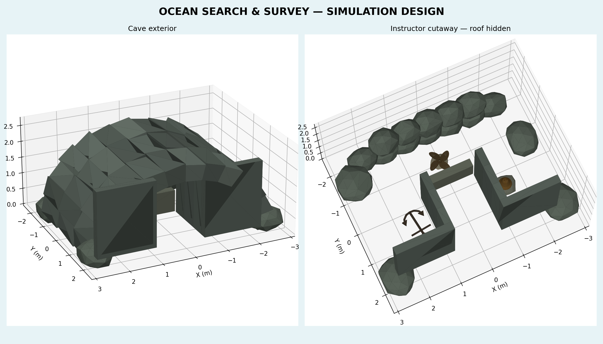
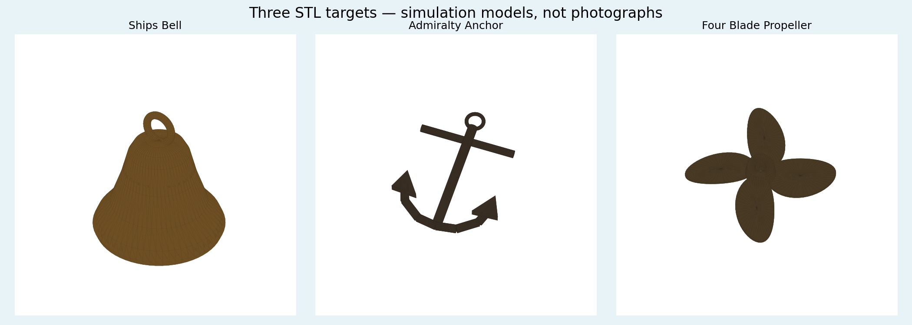

# Ocean search and survey

Three static, collidable identification targets sit inside a large rock cave on
the south side of `ocean.world`, opposite the existing northern maneuvering course.
Only the ocean world includes this mission; the team pool tasks are unchanged.

## Pilot handout

Distribute [pilot_photo_briefing.zip](pilot_photo_briefing.zip), or print
[the three-page photo briefing](briefing/pilot_photo_briefing.pdf). It contains
unaltered real photographs of a brass ship's bell, an iron Admiralty anchor and
a weathered four-blade bronze propeller. Photo authors and reuse licenses are
listed in [PHOTO_CREDITS.md](briefing/PHOTO_CREDITS.md).

The training meshes reproduce identifying shapes, without lettering or photo
backgrounds. They are simplified models, not dimensionally exact replicas of
the photographed artifacts. STL files contain geometry only; Gazebo materials
provide their colors and metallic appearance.

Suggested task: photograph each find with either camera, record its estimated
position, inspect without touching, and return to spawn. There is no automatic
scoring, randomized placement, pickup mechanism or detection algorithm.

## Instructor information — keep separate from the pilot handout

The cave origin is `(0, -4.0, -4.04)` in Gazebo ENU meters. Its mouth faces +Y,
towards spawn. The shell is approximately 5.7m wide, 3.8m deep and 2.45m tall.
The inner arch is 4.6m wide at its feet and 1.95m tall at its center. The harder
layout has a 1.5m-wide central entrance and two blind galleries behind opaque
roof-height partitions. Their entrances are at the rear: pilots must enter,
turn sideways, then look back towards the mouth to find the side targets.
Closed flanks and front caps prevent inspecting them from outside. A low rear
rock sill hides the propeller from forward views, encouraging bottom-camera
survey. Empty recesses add search choices. Reflected fill is subdued, while
ordinary camera exposure and recognizable target sizes remain unchanged.

The main passage is clear above the 0.64m sill. Keep the vehicle center about
1.04m above the cave origin while crossing it; lower to about 0.85m in the side
galleries. There are no invisible barriers. The rear wall, partitions and arch
sections have separate visible collision geometry.

| Target | World center / placement (x, y, z), m | Suggested view |
| --- | --- | --- |
| Brass ship's bell | `(-1.43, -3.55, -3.895)` | ZED looking forward from inside the west blind gallery |
| Admiralty anchor | `(1.43, -3.58, -3.985)` | Bottom camera inside the east blind gallery |
| Four-blade propeller | `(0, -5.05, -3.93)` | Bottom camera above the rear rock sill |

Coordinates above are mesh origins, not centroids. The bell is about 0.4m high,
the anchor approximately 0.9m long, and the propeller approximately 0.8m across.
They remain fixed during reset and are slightly raised above local sand relief
or supported by small stone shelves. Low reflected fill keeps RGB inspection
possible inside the cave. No camera, TF, buoyancy or vehicle-control settings
are modified by the mission.





[Download the three standalone STL files](target_stls.zip).
Actual Gazebo camera captures are in [gazebo_views](gazebo_views/):
[entrance](gazebo_views/entrance.png), [bell inspection](gazebo_views/bell.png)
and [bottom-camera survey](gazebo_views/bottom.png).
The [rear survey view](gazebo_views/rear_survey.png) shows the propeller.

## Assets and regeneration

All distances are meters, Z up. Generated assets live in
`../../worlds/assets/search_survey/`. Individual standalone object files:

- `meshes/01_ships_bell.stl`
- `meshes/02_admiralty_anchor.stl`
- `meshes/03_four_blade_propeller.stl`

`model.sdf` assembles the cave, shelves and objects with their materials and
collisions. The main world includes it once. Assets use local package URIs;
there are no network downloads during simulation.

To regenerate designs, install numpy, trimesh, matplotlib and reportlab in a
design environment, then run from the workspace root:

```bash
python3 src/robot_description/designs/search_survey/create_design.py
python3 src/robot_description/designs/search_survey/create_briefing.py
```

These are optional authoring dependencies; running the simulation only needs
the exported assets already in the repository. The generator is deterministic
and never edits the world. `mesh_manifest.json` records dimensions and triangle
counts. The pilot ZIP deliberately excludes this instructor guide and map.

Validation (ROS/Gazebo environment sourced):

```bash
gz sdf -k src/robot_description/worlds/assets/search_survey/model.sdf
python3 src/robot_description/test/check_survey_layout.py
python3 src/robot_description/test/check_search_survey.py --render
```

The layout check verifies concealment from nine entrance viewpoints, clear
inspection sightlines and sampled vehicle volumes along both gallery approaches.
The isolated Gazebo check drives a vehicle-sized box through the mouth and into
the rear-wall collision, and captures four RGB views in `/tmp/mx-survey-views`.
It does not use or stop any running SITL or simulation session.

Launch the source workspace after building/sourcing its usual install:

```bash
ros2 launch mako_bringup simulation.launch.py world:=ocean.world
```

Managed Operation MX installations use a packaged version of the world. They
receive this mission through a new desktop release; editing this checkout alone
does not change an already installed version.
